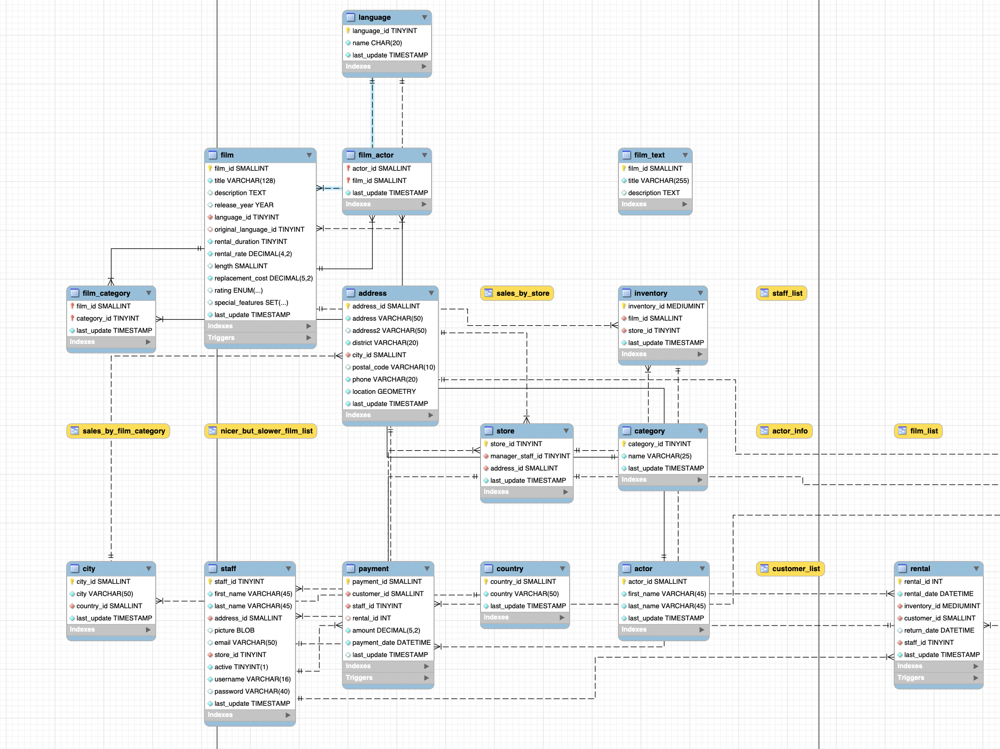

# GoArchive — Archive MySQL Rows Across Single or Multiple Relational Tables, with Parent and Child Rows

[](docs/README_LIMITATIONS.md#environment)
[](docs/README_LIMITATIONS.md#environment)
[](LICENSE)

**GoArchive respects foreign key constraints and ORM relations. Archive, copy, or purge a parent row together with every child row that depends on it — in dependency order, verified before anything is deleted.**

GoArchive is a Go CLI for archiving related MySQL rows across servers. You declare the parent-child relations once in the job config. Foreign keys the schema already declares are checked against that declaration, and relations an ORM enforces only in application code are just as valid. Copy runs parent-first and delete runs child-first, so deleting old `orders` never leaves orphaned `order_items` behind. Each batch is verified (SHA256 by default, or by row count) before its source rows are deleted, and the roots an interrupted run left in the job's log are finished when the job next starts.

## What problem does this solve?

You need to delete or archive old data from a production MySQL database, but those rows have children:

- Deleting old `orders` orphans `order_items`, `order_payments`, and `shipments`
- Deleting old `customers` breaks foreign keys three levels deep
- `ON DELETE CASCADE` silently removes rows you never archived
- Single-table archivers move the parent and leave the children behind
- Deleting in the wrong order fails with MySQL Error 1451 (`Cannot delete or update a parent row`)

GoArchive takes a declared parent-child relation tree, discovers every dependent row by walking that tree, copies the whole subgraph to an archive server **parent-first**, verifies it arrived intact, then deletes from the source **child-first**.

**Typical uses:** MySQL data retention and GDPR right-to-erasure · shrinking oversized tables to restore query performance · moving cold data to an archive server · purging staging data while preserving referential integrity.

## GoArchive vs pt-archiver

[pt-archiver](https://docs.percona.com/percona-toolkit/pt-archiver.html) is the mature, widely-adopted standard for MySQL archiving. The table below is the comparison — weigh it before choosing.

| | GoArchive | pt-archiver |
|---|---|---|
| Parent-child-aware multi-table archiving | ✅ Archives a root and its full child subgraph in dependency order | Requires custom orchestration / plugins |
| Dependency ordering | automatic, from the declared relation tree | manual, via plugin |
| Verify copy before delete | ✅ SHA256 (default) or count | ❌ |
| Inspect INSERT conversion / truncation warnings before source deletion | ✅ [checked after every application-data INSERT](docs/README_OPERATIONS.md#insert-diagnostics-and-subdivision) | No built-in check in reviewed [v3.7.1 source](https://github.com/percona/percona-toolkit/blob/v3.7.1/bin/pt-archiver) |
| Crash recovery / resume | ✅ a per-root log; interrupted roots are finished at the next start | ❌ |
| Foreign key coverage check | ✅ blocks uncovered FKs | ❌ |
| Composite primary keys | ✅ root and child, with composite foreign keys | ✅ |
| Non-integer primary keys | ✅ root and child (string, UUID, DECIMAL, temporal); FLOAT/DOUBLE, ENUM/SET and BIT keys are refused | ✅ |
| File / CSV output, `LOAD DATA INFILE` | ❌ | ✅ |
| MyISAM sources / MySQL 5.x (EOL) | Unsupported; no support planned | ✅ |
| Batched write mechanisms | Parameterized multi-row INSERT / chunked `DELETE … WHERE (key) IN (...)` | `LOAD DATA LOCAL INFILE` / range DELETE |
| PXC flow control | ❌ | ✅ |
| Extensibility | ❌ | ✅ 9 plugin hooks |

This comparison covers the reviewed pt-archiver v3.7.1 source linked above. GoArchive's
[verification policy](docs/README_CONFIGURATION.md#verification) defines the narrow
conversion-warning override. Like pt-archiver, every GoArchive run starts at the beginning of its `where` range, so a row that becomes eligible later is found by the next run. While GoArchive handles a root, the rows of its tree must not change ([the run contract](docs/README_LIMITATIONS.md#no-ddl-and-no-concurrent-writes-during-a-run-contract)).

## Is GoArchive right for your schema?

GoArchive archives **cold** data from **InnoDB** tables joined by **1:1 or 1:N** relationships,
where every participating table has a **primary key**, single-column or composite, of a
supported type ([Limitations](docs/README_LIMITATIONS.md)). Preflight rejects anything outside
that envelope before any data moves.

## The Philosophy

Archiving is a custom-coded headache that developers end up building from scratch for every new project. Because every schema is different, "off-the-shelf" tools often fall short—they either ignore your foreign keys entirely or require a massive configuration just to avoid leaving behind a mess of orphaned records.

We got tired of reinventing the wheel and worrying about data integrity every time a table got too big. So we built GoArchive.

While legendary tools like pt-archiver are excellent for offloading single tables, they often fall short in complex ecosystems because they lack an inherent awareness of deep foreign key hierarchies. If you’ve ever looked at the MySQL Sakila sample database, you know that real-world relationships are rarely linear.



GoArchive was born from the need to visualize and automate these complexities. However, to maintain the integrity of your production environment, we adhere to two core principles:

1. **Cold Data Only**
GoArchive is designed ONLY to move COLD data to an archive server—specifically for performance tuning or meeting GDPR compliance.

 > [!IMPORTANT] 
 > If you intend to archive "hot" data that is currently receiving heavy transactions, stop here. Grab a coffee, enjoy the sunshine, and reconsider your architecture. Live-data shifting is outside the scope of this tool.

2. **Zero-Impact Production Archiving**
  In high-traffic production environments, database locks are the enemy. A single record in a master table (e.g., an Order) can represent millions of rows in child tables, so GoArchive moves and purges them in configurable batches, without ever holding a long-term lock on the master table.

---

## ⚠️ Important Disclaimer

> [!WARNING]
> This tool performs data deletion on your source database (`archive`, `purge`). **Rigorously test every archive job in a staging or test environment with representative data before running it against production.**

Testing, backups and the other cautions before production: [Limitations](docs/README_LIMITATIONS.md).

## Documentation

📖 Every document, and where to start: [docs/README.md](docs/README.md).

## Features

Complete end-to-end archive, purge, and copy-only workflows:

- **Dependency ordering** - Parents are copied before their children and children deleted before their parents, following the declared relation tree, so no operation ever orphans a row
- **Referential integrity checks** - Detects foreign keys from outside the archive set pointing into it, including across schemas, and refuses to run rather than let an external `ON DELETE CASCADE` delete uncopied rows
- **Preflight before any data moves** - DELETE triggers, destination INSERT triggers, incompatible destination schemas, a `primary_key` that differs from MySQL's, unsupported key types and more, all [enumerated in Validation & Preflight](docs/README_VALIDATION.md)
- **Verification before deletion** - SHA256 (the default) or row-count comparison between source and destination, per batch; a mismatch rolls that batch back and stops the run before its delete, and batches already completed stay archived ([SHA256 verification](docs/README_VALIDATION.md#sha256-verification))
- **Crash recovery** - Each batch's roots are logged in MySQL with their status; the next start finishes the roots an interrupted run left, then the run begins again at the start of the `where` range
- **Composite and non-integer keys** - String, UUID, DECIMAL and temporal keys, single-column or composite, at the root and at every child
- **Batch processing without long locks** - Configurable batch sizes and delays
- **Replication gating** - Holds the job while any monitored replica is lagging, stopped, or unreachable, across a fleet of replicas and all their channels, then resumes the same run once they recover
- **No overlapping runs** - Advisory locks and same-root checks refuse a second run of a job, or of another job on the same root table ([Concurrency and locking](docs/README_OPERATIONS.md#concurrency-and-locking))
- **Dry-run mode** - Runs preflight, reads the first batch of root keys and shows MySQL's plan for the root fetch and each table's discovery query; writes nothing
- **Copy-only mode** - Replicate a relational subgraph to another server without ever deleting from source; with `resume: true`, a rerun skips the roots the job already copied
- **Graceful shutdown** - SIGTERM/SIGINT handling stops cleanly at a batch boundary

## Quick Start

### Installation

From a checkout:

```bash
go build -o goarchive ./cmd/goarchive
```

Release binaries, the published image, Make targets and release builds: [INSTALL.md](INSTALL.md).

### Configuration

Create a configuration file `archiver.yaml`:

```yaml
# Source database (production - data to archive)
source:
  host: localhost
  port: 3306
  user: archiver
  password: change_me
  database: production
  max_connections: 10

# Destination database (archive storage)
destination:
  host: archive.db.internal
  port: 3306
  user: archiver
  password: change_me
  database: archive
  max_connections: 10

# Archive jobs configuration
jobs:
  archive_old_orders:
    job_type: archive
    root_table: orders
    primary_key: id
    where: "created_at < DATE_SUB(NOW(), INTERVAL 2 YEAR)"
    relations:
      - table: order_items
        primary_key: id
        foreign_key: order_id
        dependency_type: "1-N"

      - table: order_payments
        primary_key: id
        foreign_key: order_id
        dependency_type: "1-N"

      - table: shipments
        primary_key: id
        foreign_key: order_id
        dependency_type: "1-1"
        relations:
          - table: shipment_items
            primary_key: id
            foreign_key: shipment_id
            dependency_type: "1-N"

# Processing settings
processing:
  batch_size: 1000
  batch_delete_size: 500
  sleep_seconds: 1

# Replication gating (optional)
replication:
  enabled: true
  seconds_behind_source_within: 10
  check_interval: 5
  servers:
    - host: replica-db.internal
      user: monitor
      password: change_me
```

`job_type` (`archive`, `purge` or `copy-only`) must match the command that runs the job. `where` is required on every job — use `where: "1=1"` to deliberately process a whole table. Verification defaults to `sha256`. A complete annotated example: [configs/archiver.yaml.example](configs/archiver.yaml.example). Every option: [Configuration](docs/README_CONFIGURATION.md).

### Basic Usage

```bash
# Check the plan from yaml:
goarchive plan -c archiver.yaml --job archive_old_orders


=================
  Relation Tree
=================

┌────────────────┐                                                 [ Tree Summary ]
│                │                                                 ----------------
│     orders     ├─────1-N──────┐                                  Root Table:     orders
│                │     │        │                                  Relations:      4 tables
└────────┬───────┘     └────────┼─────1-1───────────────┐          Max Depth:      2 levels
         │                      │                       │          Destination DB: archive
         │                      │                       │
        1-N                     │                       │          [ Processing ]
         │                      │                       │          --------------
         ▼                      ▼                       ▼          Batch Size:      1000
┌────────────────┐     ┌────────────────┐         ┌───────────┐    Batch Delete:    500
│                │     │                │         │           │    Sleep:           1.0s
│  order_items   │     │ order_payments │         │ shipments │
│                │     │                │         │           │    [ Verification ]
└────────────────┘     └────────────────┘         └─────┬─────┘    ----------------
                                                        │          Method:          sha256
                                                        │
                                                        │
                                                       1-N
                                                        │
┌────────────────┐                                      │
│                │                                      │
│ shipment_items │◄─────────────────────────────────────┘
│                │
└────────────────┘

# … followed by the execution plan; its copy and delete orders for this job:

[Copy Order (parent tables first)]
----------------------------------
  [1] orders (root)
  [2] order_items | (order_id) -> orders (id)
  [3] order_payments | (order_id) -> orders (id)
  [4] shipments | (order_id) -> orders (id)
  [5] shipment_items | (shipment_id) -> shipments (id)

[Delete Order (child tables first)]
-----------------------------------
  [1] shipment_items | (shipment_id) <- shipments (id)
  [2] shipments | (order_id) <- orders (id)
  [3] order_payments | (order_id) <- orders (id)
  [4] order_items | (order_id) <- orders (id)
  [5] orders (root)

# Validate configuration and run preflight checks
goarchive validate -c archiver.yaml

# Preview what would be archived (dry-run)
goarchive dry-run -c archiver.yaml --job archive_old_orders

# Execute archive (runs preflight, copies to destination, verifies, then deletes)
goarchive archive -c archiver.yaml --job archive_old_orders

# Copy-only (copies to destination, never deletes source); a job with job_type: copy-only
goarchive copy-only -c archiver.yaml --job copy_old_orders

# Purge only (deletes without copying - USE WITH CAUTION!); a job with job_type: purge
goarchive purge -c archiver.yaml --job purge_old_sessions
```

**Recommended workflow:** `validate` → `dry-run` → `archive`. Every command and flag: [Operations](docs/README_OPERATIONS.md).

## Architecture

```
┌─────────────┐     ┌──────────────────┐     ┌──────────────────────┐
│     CLI     │────▶│    Job config    │────▶│      Preflight       │
│   (Cobra)   │     │ (jobspec, YAML)  │     │ (dbsgomysql facts)   │
└─────────────┘     └──────────────────┘     └──────────┬───────────┘
                                                        │
                                                        ▼
┌────────────────────────────────────────────────────────────────────┐
│ Engine                                                             │
│  startup:    tracking schema → locks → job binding → recovery      │
│  batch loop: fetch root keys → discover children (parent-first)    │
│              → copy → verify → log → delete (child-first)          │
└─────────┬──────────────────────┬───────────────────────┬───────────┘
          │                      │                       │
          ▼                      ▼                       ▼
   ┌─────────────┐      ┌─────────────────┐      ┌───────────────┐
   │   Source    │      │   Destination   │      │   Replicas    │
   │   (MySQL)   │      │ + tracking log  │      │  (lag gate)   │
   └─────────────┘      └─────────────────┘      └───────────────┘
```

### Processing pipeline

1. **Preflight** - the checks that apply to the job type run before any tracking state is written ([which checks run for which command](docs/README_VALIDATION.md#which-checks-run-for-which-command), including the skip flag)
2. **Startup** - the tracking schema, the job and root-table locks, the job's binding check, then the roots an interrupted run left in the job's log are finished
3. **Batch loop** - fetch the next root keys → discover every child row, parent-first → copy, verify and log in one destination transaction → delete child-first in chunks, each its own transaction with an exact row count. Purge skips the copy and copy-only the delete. `batch_size` is the copy chunk for every table ([Tuning throughput](docs/README_OPERATIONS.md#tuning-throughput); [Resume semantics](docs/README_OPERATIONS.md#resume-semantics))
4. **Safety** - one run per job name and per root table ([Concurrency and locking](docs/README_OPERATIONS.md#concurrency-and-locking)); the replication gate holds processing before every delete chunk while any monitored replica is lagging, stopped, or unreachable; a sentinel file pauses the run, and SIGTERM/SIGINT stops it at a batch boundary

### Key Components

| Package | Purpose |
|---------|---------|
| `cmd/` | CLI command implementations (Cobra) |
| `internal/jobspec/` | Strict config loading, job rules, the relation tree |
| `internal/config/` | The shared configuration blocks and their validation |
| `internal/preflight/` | Checks by job type over dbsgomysql facts, key definitions, statement caps |
| `internal/key/` | Key definitions read from MySQL, typed keys, key SQL shapes |
| `internal/engine/` | The run loop for archive, purge and copy-only: startup, recovery, discovery, copy and verification, deletes |
| `internal/tracking/` | The tracking schema, the job registry and binding, the per-job log |
| `internal/database/` | Connection pools and their session settings |
| `internal/replication/` | Replication gate on the library's replica status facts |
| `internal/lock/` | MySQL advisory locks |
| `internal/logger/` | Structured logging with Zap |
| `internal/types/` | Temporal column metadata and read contracts |
| `internal/mermaidascii/` | ASCII diagram rendering for `plan` |

## Requirements

Each command needs specific privileges on the source, the destination and the tracking schema: [Permissions](docs/README_PERMISSIONS.md).

## Testing

How to run every test layer: [tests/README.md](tests/README.md).

## Project Status

- **Version**: `3.0.0-alpha.0` (**prerelease**)
- **Stable release**: `2.2.4-community` — the current production line.
- **Recommended for**: archival of cold MySQL data

### Planned

- Archive to BigQuery
- Observability: Prometheus metrics, OpenTelemetry traces, dashboards
- Parallelism: multi-root-PK concurrent processing, pipelining copy/verify/delete
- Admin API for runtime pause / resume / inspect
- Multi-tenancy and horizontal scale
- Adaptive rate limiting
- Web based GUI

## Related tools

- **[pt-archiver](https://docs.percona.com/percona-toolkit/pt-archiver.html)** — the mature
  single-table archiver whose one structural limit GoArchive exists to cover. See
  [the comparison above](#goarchive-vs-pt-archiver).
- **MySQL native partitioning** — if the table is partitioned by date, exchanging a whole
  partition beats any row-by-row tool:

  ```sql
  CREATE TABLE orders_2024 LIKE orders;
  ALTER TABLE orders_2024 REMOVE PARTITIONING;

  -- near-instant metadata swap
  ALTER TABLE orders EXCHANGE PARTITION p2024 WITH TABLE orders_2024;

  -- move orders_2024 to the archive server (mysqldump, or FLUSH TABLES ... FOR EXPORT
  -- plus transportable tablespace), then drop the now-empty partition
  ALTER TABLE orders DROP PARTITION p2024;
  ```

  `DROP PARTITION` on its own destroys the rows rather than archiving them, and
  `EXCHANGE PARTITION` fires no triggers and resets `AUTO_INCREMENT` on the exchanged table.

  It never competes with GoArchive: MySQL forbids foreign keys on partitioned InnoDB tables
  **in both directions**, so a partitioned table has no child subgraph to archive.

## Contributing

1. Fork the repository
2. Create your feature branch (`git checkout -b feature/amazing-feature`)
3. Commit your changes (`git commit -m 'Add amazing feature'`)
4. Push to the branch (`git push origin feature/amazing-feature`)
5. Open a Pull Request

## License

This project is licensed under the MIT License - see the LICENSE file for details.

## Acknowledgments

- [Cobra](https://github.com/spf13/cobra) - CLI framework
- [yaml.v3](https://github.com/go-yaml/yaml) - Configuration parsing
- [dbsgomysql](https://github.com/dbsmedya/dbsgomysql) - MySQL schema, privilege and replication facts
- [Zap](https://github.com/uber-go/zap) - Structured logging
- [MySQL Driver](https://github.com/go-sql-driver/mysql) - Go MySQL driver
- [mermaid-ascii](https://github.com/AlexanderGrooff/mermaid-ascii) - ASCII diagram generation for table relationship visualization
